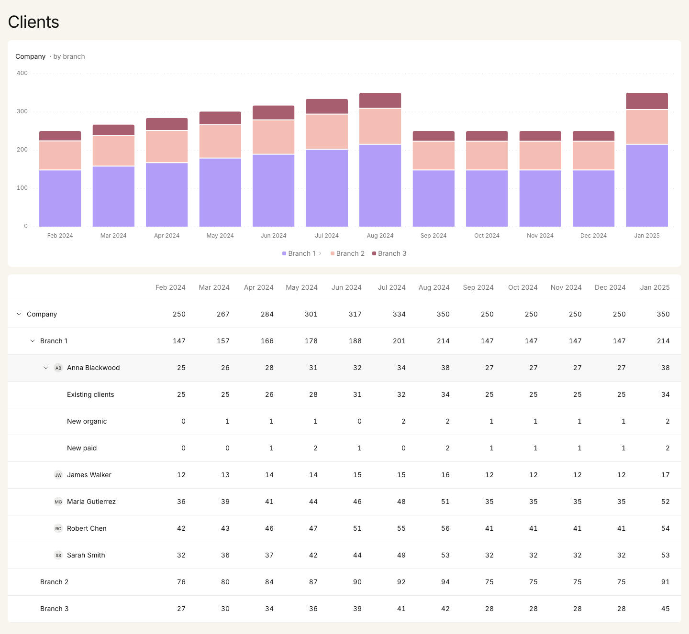

# Nevis Clients Dashboard

[](https://app.netlify.com/projects/nevis-exercise/deploys)

**Live:** https://nevis-exercise.netlify.app · API: [`/api/v1/clients`](https://nevis-exercise.netlify.app/api/v1/clients)

**For reviewers:** to see the loading and error states without waiting for a slow network or an outage, open [`?delay=2000`](https://nevis-exercise.netlify.app/?delay=2000) or [`?fail=503`](https://nevis-exercise.netlify.app/?fail=503). These demo switches exist only to review those states; they are not a product feature (see [API](#api) for how they are kept apart from real traffic).

A dashboard over the client book of business: a stacked bar chart of clients per month and a table that drills from the whole company down to a branch, an advisor and an acquisition channel. The data is served by a small Node.js REST API.



## Quick start

Requires Node 22 (`nvm use` picks it up from `.nvmrc`).

```bash
npm install
npm run dev        # API on :3001, app on http://localhost:3000
```

Try `http://localhost:3000/?delay=2000` for the loading state and `?fail=503` for the error state (demo switches for reviewing those states, not a product feature).

| Command | What it does |
|---|---|
| `npm run dev` | API (Node, watch mode) and Vite dev server; Vite proxies `/api` to the API |
| `npm run build` | Type-checks every project and builds the client into `dist/` |
| `npm start` | Production-like run: one Node process serves `dist/` and the API on :3000 |
| `npm test` / `npm run test:run` | Unit, component and screen reader tests (Vitest), watch / single run |
| `npm run test:e2e` | End-to-end and accessibility tests in Chromium and WebKit (Playwright + axe). First run: `npx playwright install chromium webkit` |
| `npm run lint` / `npm run typecheck` | Biome lint + format check / TypeScript |

## Testing

| What | How | Where |
|---|---|---|
| Expand and collapse (mouse and keyboard), the APG keyboard model, focus | Vitest + Testing Library | `src/components/tree-grid/TreeGrid.test.tsx`, `src/features/clients-report/ui/ClientsReport.test.tsx` |
| How the data maps into the chart | Pure functions: data → series → geometry; then the rendered marks | `src/features/clients-report/model/model.test.ts`, `src/components/stacked-bar-chart/*.test.ts(x)` |
| Loading, errors, retry, contract violations | MSW in place of the API | `ClientsReport.test.tsx` |
| What a screen reader announces | `@guidepup/virtual-screen-reader` | `src/features/clients-report/ui/screen-reader.test.tsx` |
| API contract, caching, errors; data consistency | `app.request()` against the Hono app | `server/*.test.ts`, `shared/*.test.ts` |
| Real browsers: keyboard, animation settling, reduced motion, CSP, 375px | Playwright, Chromium + WebKit | `e2e/` |
| WCAG 2.2 AA rules in every UI state | axe-core in Playwright | `e2e/a11y.spec.ts` |
| Manual screen reader and zoom checks | Checklist | [`docs/a11y-testing.md`](docs/a11y-testing.md) |

CI (GitHub Actions) runs lint, types, unit tests and the build, and the end-to-end suite in a second job. The same suite runs against a deployment as a smoke test:

```bash
E2E_BASE_URL=https://nevis-exercise.netlify.app npm run test:e2e
```

## Accessibility

- **Table:** a WAI-ARIA treegrid. Every row carries `aria-level`, `aria-posinset`, `aria-setsize`, and `aria-expanded` when it has children, so a screen reader announces e.g. "Branch 1, not expanded, level 2, 1 of 3". One tab stop; arrow keys move between rows and cells, Right/Left expand, collapse or go to the parent, Enter/Space toggle, Home/End jump. A row's "Show in chart" button is reached with Tab from that row (the APG pattern for widgets inside a treegrid row) and is out of the Tab order everywhere else, so the grid stays one stop; it says which row the chart shows with `aria-pressed`.
- **Chart:** the SVG is hidden from assistive technology. The chart region is one tab stop named after its scope ("Clients per month for Company, by branch, Feb 2024 to Jan 2025"); arrow keys step through months, each read out through a live region and shown in a tooltip. Drilling is available as legend buttons. The table is the full text alternative.
- **Chart on touch screens:** there is no hover, so a tap reads a month (a horizontal drag moves along months, a vertical swipe still scrolls): it shows in the tooltip, is read out through the same live region as from the keyboard, and stays until you touch elsewhere. A tap never drills, so reading a value cannot accidentally change the view; drilling stays on the legend buttons, which show it with a chevron. The tooltip sits beside the selected column, never over it, and inside the chart.
- **Motion:** honours "reduce motion" (no sliding, opacity only). **Contrast:** text passes AA; see "Colours" below for the chart. **Forced colours:** focus uses outlines, which survive Windows High Contrast.

## Deployment

Netlify: the client is static (`dist/`), the API is the same Hono app as a Node.js Netlify Function (`netlify/functions/api.ts`, routed at `/api/*`). Build settings, caching and security headers (CSP, frame and referrer policies) are in `netlify.toml`; `npm start` serves the same headers, so the end-to-end tests run under the production CSP.

## Architecture

```
server/        Hono REST API (Node entry + Netlify Function entry share one app)
shared/        API contract: zod/mini schema and the TypeScript types inferred from it
src/
  app/         entry, providers, page shell
  features/    clients-report: data fetching, pure model transforms, feature UI
  components/  generic, domain-agnostic building blocks: tree grid, stacked bar chart, UI primitives
  lib/         formatting, motion tokens, utilities
  styles/      design tokens and global CSS
```

The dependency rule is one-directional: `app → features → components → lib`. Generic components know nothing about clients, branches or advisors; the feature composes them with domain data. This is a lighter take on Feature-Sliced Design, which would be overkill for a single feature.

## API

| Endpoint | Response |
|---|---|
| `GET /api/v1/clients` | `{ data: <client tree>, meta: { periodStart: "2024-02" } }` |
| `GET /api/v1/demo/clients?delay=…&fail=…` | The same, with the demo switches (see below) |
| `GET /api/health` | `{ status: "ok" }` |

- **Contract:** `shared/clients.schema.ts` (zod/mini) is the single source of truth. The server validates its data at startup and refuses to start on a mismatch; the client validates every response, so a broken payload surfaces as an error state instead of a broken UI.
- **Period:** the brief's payload carries 12 values per node but no dates ("Feb 2024 to Jan 2025 in the design"). The API makes the period explicit in `meta.periodStart` rather than leaving month labels hard-coded in the UI.
- **Errors:** RFC 9457 problem details (`application/problem+json`) for every non-2xx response.
- **Caching:** `Cache-Control: private, max-age=60` with an `ETag`, so the browser reuses the response for a minute and then revalidates (`304 Not Modified`). `private` because client data belongs to the signed-in advisor in a real product and must not sit in a shared CDN cache.
- **Versioned path** (`/api/v1/…`), so the contract can change without breaking existing clients.
- **Demo switches (review aid only, not a product feature)** to see the loading and error states against the real API: `?delay=<ms>` (up to 3000) and `?fail=<4xx|5xx>` on the page URL are passed to `/api/v1/demo/clients`, whose responses are `no-store`. They live on their own endpoint so debug behaviour never shares a URL, or its caches, with real traffic. Production testing is what forced this: with the switches on the real endpoint, Netlify's CDN answered `?fail=503` with a stale copy of the normal response, because it serves any expired copy it holds for a path when the origin returns a 5xx, whatever the query, and neither `Netlify-Vary` nor a cache purge removed those copies. A held response keeps a serverless function busy, so `API_DEMO_SWITCHES=off` removes the endpoint; the public demo keeps it on purpose, a real production deployment would not.
- **ETag** is computed once at startup (the payload is static), not by hashing every response.

## Decisions

Each entry records what was chosen, what else was considered and why.

| Area | Choice | Alternatives considered | Why |
|---|---|---|---|
| Architecture | Feature folder + generic components, one package | Feature-Sliced Design, npm workspaces | One feature does not justify FSD layers or a monorepo; the boundaries above give the same isolation |
| API | Hono on Node 22, running TypeScript natively (type stripping) | Express, Fastify | Web-standard handler: the same `app` runs as a Node server locally and as a Netlify Function in production, with no adapter |
| Charts | Own SVG; only `nice()`/`ticks()` from `d3-array` (~2 KB) | Recharts (+119 KB gzip), visx 4 (+26 KB), `d3-scale` (+10 KB) | The chart is simple: stacked columns, a value axis, a legend. Owning it gives pixel-level control over the design and accessibility, and a pure layout function that is easy to test |
| Tree table | Own treegrid following the WAI-ARIA APG pattern | React Aria Table with expandable rows (+63 KB), shadcn/TanStack Table | No library ships treegrid semantics with the row animations in the design; owning the DOM keeps both |
| UI primitives | Own, in the shadcn style (`cva` + `cn` + CSS variables) | shadcn/ui | With the table and chart custom, only a few trivial primitives remain; headless primitives come in when overlays do |
| Animation | motion (`layout` + `AnimatePresence`), lazy-loaded features | View Transitions API, hand-written FLIP, CSS height transitions | Matches Figma's Smart Animate (rows below slide while new rows fade), animates only transform/opacity, interruptible, honours reduced motion |
| Server state | TanStack Query | Plain `fetch` + effects | Loading, error, retry and request cancellation without hand-rolled state machines |
| Design tokens | Two layers: semantic CSS variables named after the Figma variables (`--background-primary`, `--content-secondary`, …), mapped to Tailwind with `@theme inline` | Hard-coded Tailwind palette, shadcn token names | Design and code share one vocabulary; a theme is one block of variables. Only the light theme exists in the design, so only that ships |
| Fonts | Fontsource (self-hosted Inter 400) + `fontaine` (metric-matched fallback) + a 20-line Vite plugin that preloads the latin file | Google Fonts, `unplugin-fonts`, the variable font | Vite's equivalent of `next/font`: no third-party request, one preloaded 24 KB file, no layout shift on swap. The title's Inter Display cut is approximated with Inter's own tracking for 35px instead of a second file (the variable font with optical sizes is 73 KB) |
| Focus | 2px `outline` in the ink colour | Tailwind `ring` (box-shadow) | Outlines survive Windows High Contrast; box-shadows are removed there |
| Virtualization | Not yet | TanStack Virtual | The row model is already a flat list, so it can be added once real data volumes are known |
| Code splitting | The dashboard (tree grid, chart, animation runtime) is a lazy chunk whose download starts when the app loads, in parallel with the data request; motion's animation features load asynchronously | One bundle | Initial JS is 107 KB gzip (React + React DOM alone are ~74 KB); the 13 KB dashboard chunk and 32 KB of animation features are off the critical path without adding a request waterfall. A failed chunk load is retried once; a chunk that disappeared with a new deploy triggers one reload (at most once a minute) to pick up the new build |
| Roving focus | Focus position in a small external store read with `useSyncExternalStore`; rows measure layout only when the set of rows changes (`layoutDependency`) | React state in the grid | An arrow key re-renders the two elements trading the tab stop, not every row, and triggers no layout measurement |

Bundle sizes above are gzip deltas over React + React DOM, measured with Vite production builds of minimal usage of each library.

## Assumptions and open questions

### The data did not add up, so the mock was corrected

Every parent value should equal the sum of its children, and four places in the brief's payload broke that. Each looked like a typo rather than a deliberate gap (such as unassigned clients), so the mock in `server/data/clients.json` was fixed and `server/data/clients.test.ts` now guards the invariant:

| Where | Brief | Served | Reasoning |
|---|---|---|---|
| Maria Gutierrez, May 2024 | 22 | 44 | 36 → 39 → 41 → **22** → 46 breaks an otherwise steady trend; 44 also makes Company's May total (301) add up |
| Branch 1, May 2024 | 156 | 178 | Follows from the fix above |
| Robert Chen, Aug 2024 | 58 | 56 | The design shows 56, and 56 makes Branch 1's August total (214) add up |
| Anna Blackwood, New paid, May–Sep 2024 | `1, 2, 1, 0, 2` | `2, 1, 0, 2, 1` | Shifted by one month. "Existing clients" in each month equals the previous month's total, so the channel split can be checked month by month, and the shift is the only change that makes all of it add up |

If parents and children can legitimately differ in real data (clients not yet assigned to an advisor, for example), the UI should show the gap explicitly rather than hide it; the chart already handles that case (see below).

### What the chart stacks

The design's legend splits the company's bars into acquisition channels (Existing clients, New organic, New paid), but only one employee in the data has channels; for everyone else that split does not exist, and inventing it would be wrong.

So the chart shows **one scope at a time, stacked by the level beneath it**: the company by branch, a branch by advisor, an advisor by acquisition channel. That gives every scope the same reading (each bar is the scope's total, each segment one child), and at Anna Blackwood it is exactly the design's chart. The brief's "drill from the whole company down to a single branch, advisor or acquisition channel" maps onto it directly:

- **Drill down** by clicking a segment or a legend entry; legend entries are buttons, so it works from the keyboard. Only entries with a level beneath them are drillable, marked with a chevron.
- **Go back** with the breadcrumb above the chart.
- **The table follows**: drilling the chart expands the table down to the same node. The reverse is explicit rather than automatic: expanding rows to look around does not repaint the chart under the reader (and the row click already expands, per the design), so rows with a level beneath get a separate "Show in chart" button instead.
- **Non-uniform nesting:** a scope's children with nothing beneath them (Branch 2 and 3, James Walker) are plain legend entries. If children ever add up to less than their parent, the gap is drawn as an "Other" segment so the bar still matches the table; beyond five children, the rest fold into "Other" too, rather than generating colours nobody can tell apart.

### Smaller calls

- **Avatars:** the design shows photos, but the API has no image URLs, so advisors get initials. They are decorative (`aria-hidden`); the name next to them carries the meaning.
- **Default state:** as in the design, the company starts expanded with its branches showing, and the chart starts at company level.
- **Chevrons:** the design gives every branch and every advisor one. Here only rows with a level beneath get a chevron (Company, Branch 1, Anna Blackwood): Branch 2 and 3 have no advisors and the other advisors have no channel data, so a chevron would promise rows that do not exist. Those rows are not announced as expandable either.

### Additions to the design

Everything below goes beyond the mockup and prototype. Each is a deliberate addition, not a misreading of the design, and each would be worth confirming with design.

| Addition | Why |
|---|---|
| Chart drill-down: segments and legend entries drill, a breadcrumb goes back, a caption names the split ("· by branch") | The design's channel split exists for one employee only (see "What the chart stacks"); drilling makes the brief's "from the whole company down to … an acquisition channel" work in the chart too |
| "Show in chart" button on table rows that have a level beneath | The way from a row to its chart, without giving the row click (expand/collapse in the design) a second meaning. It appears on hover and focus, is always visible on touch screens, and stays visible, marked as pressed, on the row the chart currently shows. Keyboard: Tab from a focused row reaches it (the WAI-ARIA treegrid pattern for widgets in a row) |
| Chart tooltip with every series and the total, on hover, tap, or keyboard | The prototype has none; a stacked chart is hard to read without exact values |
| Keyboard walk-through of the chart (arrow keys, read out through a live region) | Keyboard and screen reader access to what the tooltip shows |
| Touch behaviour: a tap reads a month and never drills; a horizontal drag moves along months | There is no hover on touch; reading a value must not change the view by accident |
| A 2px gap between stacked segments | Separates neighbouring series whose colours have low contrast (see "Colours") |
| Series colours 4 and 5, and a grey "Other" | The design defines three colours; a branch has five advisors |
| Pinned name column and sideways scrolling inside the table card | The design is desktop-only; the brief asks that nothing break or overflow down to 375px |
| Loading skeleton, error message with retry | The design shows only the loaded state; the brief asks for loading and error handling |
| Initials instead of advisor photos | The API has no image URLs (see "Smaller calls") |
| Demo switches `?delay` and `?fail` | A review aid to see the states above on the live site, not a product feature (see "API") |

### Colours: an open question for design

The three chart colours from the design were run through a palette check (OKLCH lightness band, chroma floor, colour-blind separation under protanopia and deuteranopia, contrast on white):

| Colour | Use | Result |
|---|---|---|
| `#B29DF8` violet | first series | Contrast 2.3:1 on white, below the 3:1 for graphics |
| `#F4BEB4` peach | second series | Too light (L 0.85, band 0.43–0.77), nearly grey (chroma 0.06), 1.6:1 on white |
| `#A75E6E` maroon | third series | Chroma 0.096, just under the 0.10 floor; contrast passes |

Neighbouring pairs do separate well for colour-blind readers (ΔE ≥ 16), so the design's colours ship unchanged, backed by the mitigations WCAG 1.4.11 allows: a legend for every series, a 2px gap between stacked segments, exact values in a tooltip, and the full data in the table. Series four and five (`#4A8FC4`, `#B8860B`) were chosen to pass every check next to their neighbours. Worth raising with design: a darker peach and violet would remove the reliance on those mitigations.

### Questions for the team

- What do the values measure: client count, or something like assets under management? It changes the chart (stacked counts vs. a share of a total) and the number format.
- Why do most series drop sharply from August to September 2024 and stay flat until December? If the mock is placeholder data, fine; if not, it looks like missing data rather than a real trend.
- Is an explicit link from table to chart the right one? Here drilling the chart expands the table, while a table row reaches the chart only through its "Show in chart" button; the alternative is that expanding a row moves the chart too (see "What the chart stacks").
- Where do advisor photos come from, if the design's avatars are meant to be real?

## What I would do next

- **Run the manual screen reader pass** in [`docs/a11y-testing.md`](docs/a11y-testing.md) with VoiceOver and NVDA, and ideally with screen reader users.
- **Virtualize the table** with TanStack Virtual once real data volumes are known. The row model is already a flat list; the row animations would move from layout animation to animating within the virtualizer's positioning.
- **Load the tree lazily** for large organisations: fetch a node's children when it is expanded (`GET /api/v1/clients/:id/children`), with TanStack Query caching each level.
- **Put the view in the URL** (scope and expanded rows), so a drilled-down view can be shared and survives a reload.
- **Table features:** a total column, sorting by month, and a sticky header for long tables.
- **A dark theme** once design defines one: a block of token overrides plus a re-validated chart palette.
- **Component workshop and visual regression:** Storybook for the tree grid and chart with their states, and Playwright screenshot tests against the design.
- **API:** an OpenAPI document generated from the zod schema, and real persistence behind the endpoint.
- **Observability:** Web Vitals (INP when expanding large subtrees in particular) and error reporting.
